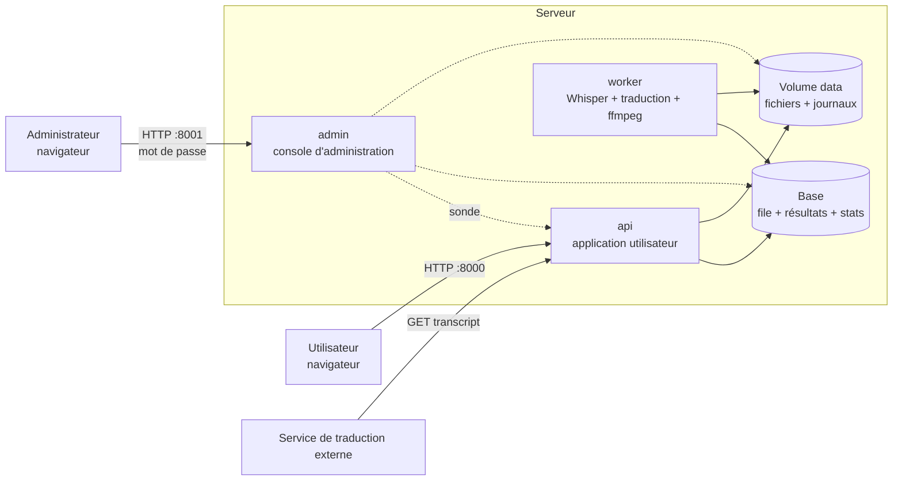

# Architecture

## Vue d'ensemble

Quatre services, décrits dans `docker-compose.yml` :

| Service | Rôle |
|---|---|
| `api` | Application utilisateur : reçoit les fichiers, crée les traitements, sert les résultats et l'interface web. Ne charge aucun modèle : il reste réactif pendant les calculs. |
| `worker` | Prend les traitements dans la file, transcrit, traduit, fabrique les fichiers avec ffmpeg. |
| `admin` | Console d'administration : état des services, usage, journaux. Ne dépend d'aucun autre service. |
| `db` | PostgreSQL : file de traitements, transcriptions, données d'usage. |

Déroulé d'un traitement : dépôt (`POST /api/uploads`) → lancement (`POST /api/jobs`, statut
`queued`) → le worker le prend (`processing`) → extraction audio 16 kHz mono → transcription
→ traduction si demandée → fabrication des fichiers selon le type demandé → `done` ou
`failed`. Le worker écrit l'étape et le pourcentage en base ; l'interface les lit toutes les
0,7 s et affiche la barre de progression.
## Choix et justifications

**Traitement asynchrone (API + worker séparés).** Une transcription dure de quelques secondes
à plusieurs minutes : la faire dans la requête HTTP bloquerait l'utilisateur, casserait sur un
timeout et empêcherait de servir 10 personnes. La file absorbe les pics et permet d'afficher
une position d'attente.

**File de traitements dans PostgreSQL plutôt qu'un broker (Redis, RabbitMQ).** Au volume visé
(10 utilisateurs), une table suffit, et cela fait un composant de moins à installer, surveiller
et sauvegarder. La prise d'un traitement est une mise à jour conditionnelle atomique
(`UPDATE ... WHERE status = 'queued'`), donc plusieurs workers peuvent coexister. Les
statistiques demandées par l'administrateur se lisent directement dans cette même table.

**Reprise après crash.** Le worker écrit un signal de vie toutes les 10 s pour chaque
traitement en cours. Un traitement sans signal depuis 60 s est remis en file (3 tentatives
maximum, puis échec explicite). Rien n'est gardé en mémoire : un redémarrage ne perd aucun
traitement.

**Modèles en greffons.** `Transcriber` et `SpeakerIdentifier` sont deux interfaces avec un
registre. Ajouter un modèle ou l'identification du speaker ne touche ni à l'API, ni à la file,
ni à l'interface. Le champ `speaker` existe déjà dans les segments, les sous-titres et l'API.

**Souveraineté.** Modèle exécuté localement, stockage sur un volume du serveur, aucune
dépendance à une API externe. Seul le téléchargement initial des poids sort du réseau ; il peut
être évité en préremplissant le volume `models`.

**Whisper exécuté avec faster-whisper (CTranslate2) plutôt que transformers.** Ce sont les
mêmes poids OpenAI que le prototype (`whisper-medium.en`), mais mesuré sur l'échantillon
fourni, le pipeline transformers du prototype rendait un premier sous-titre de 2 min 08 d'un
seul bloc (horodatages perdus à la fusion des fenêtres) et mettait 95 s sur CPU avec
`small.en`. faster-whisper rend 52 sous-titres de 6,4 s au plus en 13 s, sans dépendre de
PyTorch, sur CPU (int8) comme sur GPU (float16).

**Un seul moteur de base de données.** PostgreSQL, sous Docker comme en développement
(`docker compose up -d db` suffit à l'établi). Les deux déploiements ne diffèrent que par la
configuration. SQLite a été abandonné : le schéma comporte des comptes, des contraintes de
clé étrangère avec suppression en cascade, des verrous consultatifs pour les migrations
simultanées, et les tests doivent tourner sur le moteur de production.

**CPU ou GPU, choisi au lancement.** L'équipe développe sur deux machines, l'une sans GPU,
l'autre avec un GPU NVIDIA. Un seul réglage, `DEVICE`, posé par les scripts de lancement,
détermine tout ce qui dépend du matériel : précision de calcul (int8 ou float16), modèle par
défaut, taille des lots, et, sous Docker, l'image construite (les bibliothèques CUDA, près de
4 Go, ne sont installées que dans la version GPU) ainsi que l'accès du worker au GPU. Le moteur
d'inférence (CTranslate2) et le code sont identiques dans les deux cas. Un GPU demandé mais
inutilisable arrête le worker avec un message clair plutôt que de retomber sur le CPU en
silence.

**Une seule image Docker.** Application, console et worker partagent la même image et ne
diffèrent que par leur commande : une construction, un seul artefact à versionner et à
déployer. Elle tourne sous un utilisateur non privilégié. Le modèle de traduction y est
converti à la construction, dans une étape séparée, pour que PyTorch n'entre pas dans
l'image finale.

**Console d'administration séparée.** L'exigence est que l'administrateur garde la main quand
le site tombe. La console est donc un autre processus, sur un autre port, sans aucun lien
depuis l'application utilisateur (et inversement), avec son propre mot de passe. Elle se
connecte à la base à la demande : si la base est injoignable elle démarre quand même et
affiche l'état des services et les journaux, que chaque service écrit dans des fichiers du
volume partagé. Vérifié en arrêtant brutalement l'application : la console la signale « à
l'arrêt », ses journaux restent lisibles, puis elle repasse « en service » après la relance
automatique.

**Traduction locale en greffon.** Le français est produit par `opus-mt-en-fr`
(Helsinki-NLP, Apache 2.0) converti pour CTranslate2 : même moteur que Whisper, pas de
PyTorch à l'exécution, 80 Mo. Les sous-titres étant souvent des fragments de phrase, ils sont
regroupés en phrases, traduits, puis redistribués sur les horodatages d'origine au prorata
des longueurs. L'interface `Translator` permet de brancher à la place le service de traduction
du client.
**Correction des sous-titres sans retranscrire.** Le texte corrigé par l'utilisateur est
enregistré à côté de la transcription d'origine, puis le même traitement repasse dans la file
pour refaire uniquement les fichiers. Mesuré : 3 s pour refaire une vidéo incrustée de
2 min 29, contre 16 s pour le traitement complet.

**Annulation coopérative.** Annuler passe le traitement à l'état « annulé » en base ; le
worker s'en aperçoit en écrivant sa progression et s'arrête (ffmpeg est tué, le dossier de
travail supprimé). L'arrêt est immédiat pendant l'incrustation, et attend la fin du lot en
cours pendant la transcription (une vingtaine de secondes au plus sur CPU).

**Mise en forme des sous-titres.** Deux lignes de 42 caractères au plus, équilibrées ; un
segment plus long est réparti sur plusieurs sous-titres au prorata du texte. En incrustation
grande taille la limite passe à 32 caractères, pour ne pas dépasser deux lignes à l'image.

**Transcription mise en cache.** Demander un second type de résultat pour le même fichier
réutilise la transcription : seul ffmpeg est relancé.

**Interface sans chaîne de build.** HTML/CSS/JS statiques servis par l'API : pas de Node à
installer ni de second service à déployer.

## Traitements simultanés et voie rapide

Besoin : si un utilisateur dépose une vidéo de 30 min et qu'un autre dépose une vidéo de
2 min, le second ne doit pas attendre 30 min. Deux mécanismes y répondent.

1. **Les traitements avancent de front.** Un worker mène `WORKER_CONCURRENCY` traitements à la
   fois (3 par défaut). Whisper traite l'audio par lots de quelques minutes ; les traitements
   en cours se partagent le modèle lot par lot au lieu de se suivre. Une vidéo courte n'attend
   donc au pire que la fin du lot en cours d'une vidéo longue.
2. **Une voie rapide est réservée aux fichiers courts.** `FAST_LANE_SLOTS` emplacements (1 par
   défaut) ne prennent que les médias de moins de `FAST_LANE_MAX_S` secondes (5 min). Même si
   tous les autres emplacements sont occupés par des fichiers longs, un fichier court démarre
   immédiatement. Les fichiers longs, eux, sont pris dans l'ordre d'arrivée.

Mesure sur le poste de développement (CPU seul, `whisper-small.en`) : deux vidéos de 29 min
47 s lancées ensemble, puis l'échantillon de 2 min 29 soumis 8 s plus tard avec traduction.

| Fichier | Demande | Résultat disponible après |
|---|---|---|
| Vidéo courte (2 min 29) | vidéo + sous-titres en français | **41 s** |
| Vidéo longue B (29 min 47) | sous-titres | 5 min 39 |
| Vidéo longue A (29 min 47) | vidéo incrustée en français | 6 min 54 |

Sans ces mécanismes, la vidéo courte aurait attendu la fin d'une vidéo longue, soit plus de
5 min. Seule sur la machine elle prend 15 s : le partage du processeur avec les deux longues
la ralentit, mais elle reste servie en bien moins que sa propre durée.

Limite : la voie rapide protège les fichiers courts, pas les fichiers longs entre eux. Avec
plus de fichiers longs que d'emplacements, les suivants attendent leur tour.

**Finesse de la barre de progression.** Pendant la transcription, le pourcentage avance à
chaque lot terminé (`BATCH_SIZE` fenêtres de 30 s, soit 4 min d'audio par défaut). Sur un
fichier de quelques minutes la barre fait donc peu de paliers ; elle est fluide sur les
fichiers longs et pendant l'incrustation vidéo. Réduire `BATCH_SIZE` l'affine au prix d'un
débit un peu plus faible.
## Limites et conservation des fichiers

**Limites par fichier.** 2 Go et 2 h par défaut. La durée est la vraie mesure du coût : le
calcul lui est proportionnel et l'audio est chargé entièrement en mémoire (environ 230 Mo par
heure et par traitement). À 2 h, un traitement représente de l'ordre de 11 min de calcul sur
le CPU de développement et 460 Mo de mémoire ; trois de front restent confortables sur 32 Go.
Un fichier dont la durée est illisible est refusé dès le dépôt plutôt que d'échouer plus tard.

**Plafond de la file.** Sans limite, le service accepterait plus de travail qu'il ne peut en
rendre dans des délais raisonnables. Un traitement est refusé quand la durée de média en
attente ou en cours (les traitements en cours ne comptent que pour ce qu'il leur reste), plus
la sienne, dépasse `MAX_PENDING_MEDIA_S` (4 h par défaut). Une file vide accepte toujours, pour
qu'un fichier seul ne soit jamais refusé. La limite est exprimée en durée de média et non en
nombre de traitements, parce que c'est la durée qui fait la charge. S'y ajoute un plafond de
4 traitements actifs par utilisateur. Le scénario de référence (10 utilisateurs, 2 min 29 chacun,
soit 25 min de média) reste très en dessous du plafond.

Une règle plus stricte, refuser dès que la promesse « plus rapide que la durée du média » ne
peut plus être tenue, a été écartée : elle refuserait à tort les fichiers courts que la voie
rapide sert pourtant en quelques dizaines de secondes.

**Envoi par morceaux avec reprise.** Le navigateur envoie le fichier par morceaux de 8 Mo dans
une session d'envoi. Le serveur n'ajoute un morceau que s'il commence exactement là où il en
est, sinon il répond avec sa position réelle : un morceau perdu ou envoyé deux fois ne peut pas
corrompre le fichier. L'état est sur disque et en base, donc il survit à un redémarrage.
Vérifié avec un fichier de 185 Mo : application tuée à mi-envoi, relancée automatiquement,
envoi terminé et fichier reçu identique à l'original (empreinte SHA-256). Un utilisateur n'a
qu'un envoi en cours à la fois, et un envoi abandonné est effacé après 24 h.

**Purge automatique.** Le worker passe toutes les 10 s et supprime les fichiers (dépôt et
résultats) de tout dépôt qui n'est plus le dernier de son propriétaire, ou qui a plus de
`RETENTION_DAYS` jours. Un fichier dont un traitement est en attente ou en cours n'est jamais
supprimé. Les lignes en base sont conservées : l'exigence « contenu des réponses » et les
compteurs de l'administrateur ne dépendent pas des fichiers.

« Le dernier fichier de chacun » repose sur le compte du dépôt. Une règle globale (ne garder
que le dernier fichier du serveur) aurait supprimé les résultats des autres utilisateurs à
chaque dépôt, ce qui est incompatible avec 10 utilisateurs en parallèle.

## Comptes et base de données

**Schéma.** `users` (nom en minuscules, unique ; mot de passe haché ; rôle `user` ou `admin` ;
`disabled_at`), `auth_sessions` (une ligne par connexion), `uploads` et `upload_sessions`
(rattachés à un compte par clé étrangère), `jobs` (rattachés à un dépôt), `workers`. Les
suppressions se propagent en cascade : compte, puis dépôts, puis traitements.

**Les médias ne sont pas dans la base.** Les fichiers (jusqu'à 2 Go) restent sur le disque :
mettre des vidéos dans PostgreSQL gonflerait la base, ralentirait sauvegardes et reprises
d'envoi, et empêcherait de servir un fichier en flux. La base fait le lien : propriétaire,
chemin, taille, durée, liste des fichiers produits. La taille est un `BIGINT` : un fichier de
plus de 2 Gio dépasse un entier de 32 bits.

**Mots de passe.** Hachés avec argon2id (paramètres par défaut d'`argon2-cffi`), jamais
stockés ni journalisés ; longueur bornée à 128 caractères pour qu'un mot de passe démesuré ne
serve pas à saturer le processeur. Un nom inconnu et un mauvais mot de passe prennent le même
temps et reçoivent la même réponse.

**Sessions.** Jeton aléatoire de 256 bits dans un cookie HttpOnly ; la base ne garde que son
empreinte SHA-256, donc une fuite de la base ne donne aucune session utilisable. Chaque
connexion peut être révoquée (déconnexion, changement de mot de passe, désactivation du
compte). Le worker purge les sessions expirées.

**Administrateur.** Un compte comme les autres, de rôle `admin`, avec son propre cookie
(`admin_session`) : une session d'utilisateur n'ouvre pas la console. Conséquence assumée : la
connexion à la console dépend de la base. Un administrateur déjà connecté garde les journaux
et l'état des services pendant une panne de la base, grâce à un cache des sessions déjà
validées ; c'est là qu'il en a le plus besoin.

**Migrations.** Alembic, appliquées au démarrage de chaque service sous un verrou consultatif
PostgreSQL (les trois services démarrent ensemble). Un test compare le schéma produit par les
migrations à celui des modèles. La migration `0001` remplace les tables d'avant les comptes :
leurs dépôts, liés à un cookie anonyme, n'avaient pas de propriétaire.

**Inscription ouverte.** Tout le monde peut créer un compte, donc le nombre de créations est
limité par adresse IP (`MAX_REGISTRATIONS_PER_HOUR`) et les échecs de connexion sont comptés
(5 par minute et par adresse). Ces compteurs sont en mémoire de chaque processus : ils freinent
la devinette de mots de passe sans remplacer un pare-feu ou un reverse proxy.

## Corrections apportées au prototype

| Prototype (`test_pipeline_3.py`) | Version industrialisée |
|---|---|
| Secondes des horodatages SRT sur un chiffre (`00:00:5,000`), fichier illisible par certains lecteurs | Format `HH:MM:SS,mmm` strict, testé |
| Numéros de sous-titres non consécutifs quand un segment est ignoré | Numérotation continue |
| Plantage si Whisper ne fournit pas l'horodatage de fin du dernier segment | Durée par défaut |
| Métadonnées de la piste de sous-titres écrites sur une piste inexistante (`s:s:1`) | Langue et titre sur la piste `s:s:0` |
| Langue de la piste écrite `en`, ignorée par le conteneur mp4 | Code ISO 639-2 (`eng`) |
| Sous-titres de plusieurs minutes d'un seul bloc (fusion des fenêtres) | Segments de quelques secondes (voir faster-whisper ci-dessus) |
| Fichier, type de sortie et GPU codés en dur | Paramètres d'API et de configuration |
| Audio extrait au format d'origine | 16 kHz mono, format natif de Whisper |

## Sécurité et limites connues

- La console d'administration est un service séparé, réservé aux comptes de rôle `admin`, avec
  blocage d'une minute après 5 échecs et sessions de 8 heures enregistrées en base. À publier
  en HTTPS uniquement.
- Les utilisateurs s'authentifient par un compte (inscription ouverte). Un fichier et ses
  résultats sont liés à ce compte : pour tout autre compte, toute lecture ou action répond 404,
  comme pour un identifiant inconnu ; sans connexion, 401. Le cookie de session est HttpOnly,
  SameSite Lax et marqué Secure en HTTPS (ou si `COOKIE_SECURE=true` derrière un proxy). Pas de
  récupération de mot de passe par courriel : l'administrateur le réinitialise
  (`python -m app.users passwd`). À exposer en HTTPS.
- Extensions limitées à `.mp4` / `.wav`, taille plafonnée (`MAX_UPLOAD_MB`), noms de fichiers
  jamais utilisés comme chemins.
- Supprimer un compte directement en base supprime ses lignes en cascade mais pas ses fichiers
  sur le disque ; la purge automatique ne les retrouve plus (elle part des lignes en base).
- La traduction fournie va de l'anglais vers le français uniquement.
- La correction porte sur le texte, pas sur les horaires des sous-titres.
- Traduction automatique généraliste : à relire avant diffusion (noms propres, expressions).
- Les sous-titres incrustés sont figés dans l'image : leur style se choisit avant le
  traitement. Le réglage en direct dans le lecteur ne concerne que la piste de sous-titres.
- Les migrations sont écrites à la main (Alembic) et relues : un test signale tout écart avec les
  modèles.

## Performances et dimensionnement

Exigence : résultat en moins de temps que la durée du média, jusqu'à 10 utilisateurs en
parallèle.

**Raisonnement.** Le worker sérialise l'inférence sur le GPU. Si un traitement coûte
`r × durée` (r = rapport calcul / durée du média), le dernier de 10 traitements identiques
soumis en même temps attend `10 × r × durée`. L'exigence est donc tenue tant que **r < 0,1**
pour le traitement complet.

### Mesures sur CPU seul

Poste de développement : Ryzen 7 7700 (8 cœurs), 32 Go, **sans GPU utilisable**, lancement
local, échantillon fourni `input.mp4` (148,9 s), `scripts/benchmark.py`.

Transcription seule (8 threads, lots de 8) :

| Modèle | Temps | r |
|---|---|---|
| `whisper-small.en` | 13 s | 0,09 |
| `whisper-medium.en` | 40 s | 0,27 |

Application complète, `whisper-small.en`, attente dans la file comprise :

| Scénario | Résultat le plus lent | × durée | Exigence |
|---|---|---|---|
| 1 utilisateur, vidéo + sous-titres | 15,4 s | 0,10 | tenue |
| 1 utilisateur, vidéo incrustée | 19,2 s | 0,13 | tenue |
| 10 utilisateurs simultanés, sous-titres seuls | 130,4 s | 0,88 | tenue |
| 10 utilisateurs simultanés, vidéo incrustée (`superfast`, défaut) | 135,6 s | 0,91 | tenue |
| 10 utilisateurs simultanés, vidéo incrustée (`veryfast`, ancien défaut) | 156,5 s | 1,05 | manquée de 7,6 s |

Lecture : sur CPU seul, `small.en` est à la limite pour 10 utilisateurs (10 × 13 s de
transcription ≈ 130 s pour 149 s de média) et `medium.en` ne tient que jusqu'à 3 utilisateurs
simultanés environ. L'incrustation (`libx264`, 2 à 4 s ici selon le préréglage) tourne en parallèle de
l'inférence mais lui prend des cœurs. Les trois autres sorties ne ré-encodent rien.

### Sous Docker (CPU)

Même poste, pile Docker complète (Docker Desktop, moteur WSL 2, PostgreSQL), image `cpu`,
`whisper-small.en`, préréglage d'incrustation par défaut :

| Scénario | Résultat le plus lent | × durée | Exigence |
|---|---|---|---|
| 10 utilisateurs simultanés, sous-titres seuls | 102,8 s | 0,69 | tenue |
| 10 utilisateurs simultanés, vidéo incrustée | 118,0 s | 0,79 | tenue |

C'est plus rapide que le lancement direct sous Windows (130,4 s et 135,6 s) : les bibliothèques
de calcul sont mieux servies par Linux. L'exigence des 10 utilisateurs est donc tenue sur CPU
seul, avec de la marge, dans la configuration de déploiement.

Vérifié sur cette pile : construction de l'image, démarrage des quatre services, traitement
réel des quatre types de sortie avec traduction et correction, les 87 tests automatisés rejoués
dans l'image sur PostgreSQL, relance automatique de l'application après l'arrêt de son
processus, console d'administration utilisable base de données arrêtée.

### Modèles multilingues

Les modèles `.en` ne comprennent que l'anglais ; les modèles sans suffixe détectent la langue.
Transcription seule sur le poste de développement (CPU, 8 threads) :

| Modèle | Échantillon anglais (2 min 29) | Audio français (38 s) |
|---|---|---|
| `whisper-small.en` | 12,8 s, r = 0,09 | texte inutilisable |
| `whisper-small` | 15,2 s, r = 0,10 | 4,5 s, r = 0,12, langue détectée |
| `whisper-large-v3-turbo` | 29,5 s, r = 0,20 | 11,2 s, r = 0,30, langue détectée |

L'audio français de test est une voix de synthèse, donc plus facile qu'un enregistrement réel :
il valide la détection de langue et la chaîne complète, pas la qualité sur de vraies réunions.

À 10 utilisateurs simultanés, `whisper-small` est à la limite sur CPU : 148,4 s pour 148,9 s
de média en sous-titres seuls, et 166,7 s (objectif manqué) en vidéo incrustée. C'est pourquoi
le modèle par défaut reste `whisper-small.en` ; le multilingue se choisit dans l'interface, et
un GPU sur le serveur cible lèverait ce compromis.

### Incrustation des sous-titres : options mesurées

L'incrustation ré-encode toute la vidéo ; c'est elle qui faisait manquer l'objectif à
10 utilisateurs. Mesures sur le poste de développement, échantillon de 2 min 29 (640×360,
60 images/s) et le même agrandi en 1920×1080, un seul encodage à la fois :

| Encodeur | 360p : temps | 360p : taille | 1080p : temps | 1080p : taille |
|---|---|---|---|---|
| `libx264 veryfast` | 3,9 s | 14,3 Mo | 20,6 s | 58,9 Mo |
| `libx264 superfast` (défaut) | 2,4 s | 24,1 Mo | 16,3 s | 94,9 Mo |
| `libx264 ultrafast` | 1,4 s | 50,3 Mo | 11,3 s | 187,8 Mo |
| `h264_amf` (GPU AMD) | 7,5 s | 29,6 Mo | 14,2 s | 132,7 Mo |

Effet sur le scénario qui échouait (10 utilisateurs simultanés, vidéo incrustée, résultat le
plus lent, une mesure par réglage) :

| `BURN_PRESET` | Résultat le plus lent | × durée | Exigence |
|---|---|---|---|
| `veryfast` | 156,5 s | 1,05 | manquée |
| `superfast` (défaut) | 135,6 s | 0,91 | tenue |
| `ultrafast` | 132,8 s | 0,89 | tenue |

Lecture : un préréglage plus rapide libère des cœurs pour la transcription, d'où un gain bien
supérieur au temps d'encodage économisé. `superfast` suffit à tenir l'exigence pour un fichier
environ 1,7 fois plus lourd ; `ultrafast` n'apporte presque rien de plus et triple le poids.
L'encodeur matériel AMD n'est pas intéressant ici : plus lent en petite définition, et le
décodage comme le rendu des sous-titres restent sur le processeur.

### Cible serveur avec GPU

Sur un GPU de classe T4 / L4 en float16, faster-whisper est donné pour plusieurs fois plus
rapide que ce CPU, ce qui laisserait de la marge pour `medium.en` à 10 utilisateurs.

> **Cette configuration GPU n'a pas été exécutée** : pas de GPU NVIDIA sur le poste où ces
> mesures ont été faites. L'image `gpu` y a été construite (5,4 Go, contre 1,7 Go pour `cpu`)
> et contient bien les bibliothèques CUDA, mais aucune inférence n'a tourné sur GPU. À valider sur la machine cible avec
> `python scripts/benchmark.py input.mp4 --users 10 --output-type video_embedded`. La page
> d'administration affiche ensuite le rapport calcul / durée en continu sur l'usage réel.

Leviers si la mesure dépasse : `whisper-small.en` par défaut, augmenter `BATCH_SIZE`,
ajouter des vCPU pour l'incrustation, ou lancer un second worker sur une autre machine ou un
second GPU (`docker compose up -d --scale worker=2`).

**Infrastructure estimée**

| Élément | Dimensionnement |
|---|---|
| Machine | 1 instance GPU : 1 GPU 16–24 Go (T4 / L4), 8 vCPU, 32 Go de RAM |
| Disque | 200 Go SSD (fichiers déposés + résultats + modèles) |
| Réseau | 1 IP, HTTPS par reverse proxy |

**Coût.** Chez un hébergeur européen (souveraineté), une instance de cette classe se loue de
l'ordre de 0,75 €/h, soit environ 6 600 €/an allumée en continu, plus le stockage : sous le
plafond de 10 000 €/an. Arrêter l'instance hors heures ouvrées (≈ 50 h/semaine) ramène la
facture à environ 2 000 €/an. Tarif indicatif à confirmer sur la grille du fournisseur retenu
avant la soutenance.
